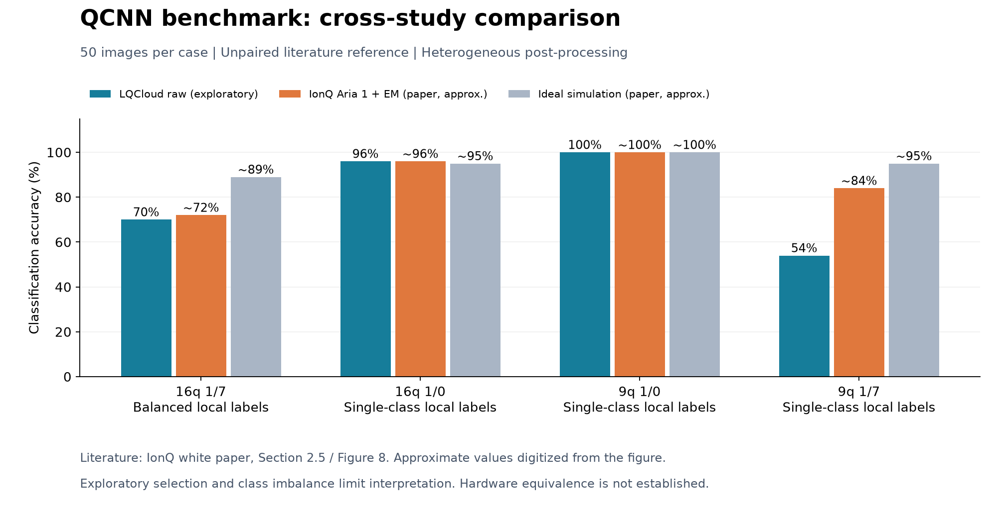
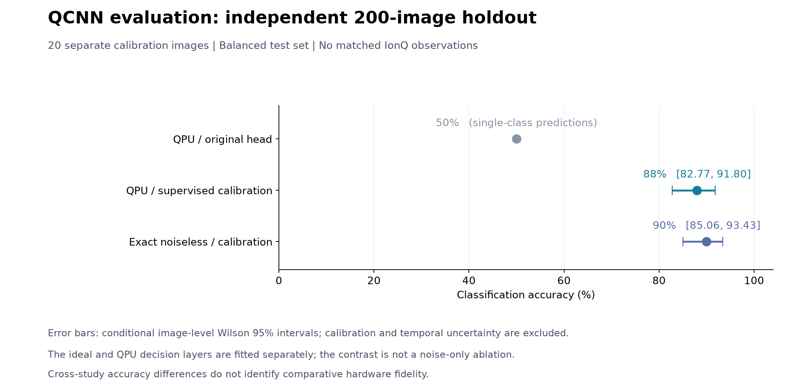

# QCNN 在 LQCloud 上的实验评估

## 摘要

本研究基于 IonQ 发布的 QCNN 应用基准，评估 LQCloud 实机上的 MNIST 数字分类性能，并分别建立公开基准的文献参照与独立测试集的无噪声参照。公开的 16 比特、1/7 平衡任务中，探索阶段保留的 LQCloud raw 结果为 35/50（70%），IonQ 白皮书的 Aria 1 加自定义误差缓解结果约为 72%。由于后处理、采集条件及资源预算未完全对齐，该比较属于非配对的跨研究参照。

在另设的 200 张独立留出图片上，利用 20 张独立有标签图片进行经典监督校准，并采用预先固定的聚合规则，LQCloud 实机结果为 176/200（88.00%，条件性 Wilson 95% 区间 82.77%–91.80%）；对应校准规则下的精确无噪声参考为 180/200（90.00%）。原分类头在同批实机特征上产生单类别预测，准确率为 100/200（50.00%）。时间重复测量尚未确立持续的 88%–90% 应用性能。

本仓库提供实验报告、匿名化逐图预测、统计与绘图程序、参数外置的核心实验实现及自动化测试。公开材料支持从预测记录重建主要统计结果；不包含完整重现实机采集所需的设备配置及模型参数。

## 1. 研究对象与比较设计

任务定义与基准资产来源于 [IonQ apps-benchmark](https://github.com/ionq-publications/apps-benchmark)。QCNN 将量子测量特征输入经典分类层，以测试集准确率作为应用指标。研究区分以下评估条件：

| 条件 | 数据与处理流程 | 比较边界 |
|---|---|---|
| LQCloud raw | 实机原始测量统计与原仓库分类头 | 未增加本文的监督校准；仍包含必要编译及原有经典后处理 |
| LQCloud 监督校准 | 在独立有标签校准集上拟合经典决策层，并按固定规则聚合 | 应用层适配，不是设备物理校准或预测概率校准 |
| 精确无噪声参考 | 状态向量计算与对应经典分类规则 | 软件参考，并非 IonQ 实机数据或准确率上限 |
| Aer 有限采样参考 | 本地无噪声模拟器的一次有限采样结果 | 不等同于精确期望值 |
| IonQ 文献实机结果 | 白皮书 Aria 1＋EM 系列 | 包含自定义误差缓解，不属于 raw QPU 对照 |

详细方法及代码对应关系见 [METHODS.md](METHODS.md)。本研究未直接访问 IonQ 实机；所有 IonQ 硬件结果均标记为文献引用。

## 2. 公开基准与 IonQ 文献对照

IonQ 数值取自[官方白皮书](https://www.ionq.com/resources/benchmarking-white-paper)第 2.5 节、第 23 页图 8。论文每个任务使用 50 张测试图。图 1 展示 LQCloud 探索性观测及对应文献结果。

| 任务 | 本地公开资产的标签构成 | LQCloud raw | 本地 Aer 有限采样 | 文献理想模拟，约值 | IonQ Aria 1＋EM，约值 |
|---|---:|---:|---:|---:|---:|
| 16 比特，1/7 | 25/25 | **35/50＝70%** | 40/50＝80% | ≈89% | **≈72%** |
| 16 比特，1/0 | 50/0 | 48/50＝96% | 48/50＝96% | ≈95% | ≈96% |
| 9 比特，1/0 | 50/0 | 50/50＝100% | 49/50＝98% | ≈100% | ≈100% |
| 9 比特，1/7 | 50/0 | 27/50＝54% | 48/50＝96% | ≈95% | ≈84% |

16 比特 1/7 任务的两项实机点估计相差约 2 个百分点，相当于 50 图准确率的一个计分单位。该差值不构成逐图配对差异或硬件等效性证据：未获得 IonQ 的逐图预测、图片身份及完整执行信息，无法认证两项研究使用完全相同的图片版本。

另外三项本地任务的测试标签仅包含一个类别。其高准确率不能单独支持二分类泛化性能，亦不能据此推断 IonQ 原文未披露的标签分布。LQCloud 条目汇总了开发阶段保留的观测配置，存在探索性选择，且各任务的执行条件不同；不将其解释为统一配置下的确认性评估。

文献实机值由图中柱高读取；理想模拟值取整至约一个百分点。原文 QCNN 小节及图注未提供 raw 实机系列或每条线路的采样次数。16 比特 1/7 任务的本地 Aer 有限采样结果与文献理想模拟值不同；由于模拟设置尚未全部对齐，该差异不用于硬件归因。

## 3. 独立留出评估与无噪声参考

独立评估采用另外 220 张图片，其中 20 张用于监督校准、200 张用于测试，两部分均按类别平衡。样本与此前公开评估及开发样本的源身份不重叠，并进行了输入近重复检查。测试身份、校准/测试划分、既定方法及评分规则在本轮结果产生前本地冻结；该过程不等同于外部公开预注册。测试标签未参与拟合或本轮方法选择，全部测试图片均纳入评分。

| 条件 | 正确数 | 准确率 | 条件性 Wilson 95% 区间 |
|---|---:|---:|---:|
| 实机特征，原分类头 | 100/200 | 50.00% | —（单类别预测） |
| 实机特征，监督校准与固定聚合 | **176/200** | **88.00%** | **82.77%–91.80%** |
| 精确无噪声特征，对应校准规则 | 180/200 | 90.00% | 85.06%–93.43% |

原分类头将全部 200 张图片预测为数字 7，50% 准确率由平衡测试集的类别比例决定。监督校准方案对数字 7 和数字 1 的正确数分别为 83/100 和 93/100；混淆矩阵为 [[83,17],[7,93]]，行表示真实类别、列表示预测类别，顺序均为 [7,1]。

三项条件的分类器或聚合方式并不完全相同，因此 50% 与 88% 的差异不构成校准步骤的单因素消融效应。无噪声与实机流程使用相同校准图片身份及质心分类规则，但分别在各自的特征空间中拟合；实机采用固定的多路聚合，理想等价线路产生相同特征。88% 与 90% 的差异是应用流程的点估计差异，不能解释为硬件噪声仅造成两个百分点的损失。

同图配对分析中，实机独自正确 11 张，无噪声参考独自正确 15 张；描述性精确 McNemar 双侧检验 p＝0.557。研究未预先设定等效界值，未检出差异不构成等效性结论。精确参考的 90% 不是准确率上限。

没有 IonQ 在本节 200 张图片、相同校准预算与后处理协议下的实机结果。因此，本节 88% 与文献约 72% 不具备直接比较硬件性能的条件。

## 4. 不确定性与时间稳定性

Wilson 区间是固定拟合模型和采集条件下的图片层面二项近似，不同时覆盖校准样本选择、有限测量统计、相关噪声及设备时间变化。固定平衡抽样也限制了其向任意类别比例下部署性能的外推。独立留出降低了测试泄漏风险，但不足以排除全部过拟合风险。

对保留方法所做的条件性敏感性分析如下。该表是已有分析的汇总值；由于相应测量计数与校准特征不公开，不能仅凭本仓库的预测记录重新生成这些重采样分布。

| 条件性分析 | 准确率中位数 | 95% 分布范围 |
|---|---:|---:|
| 独立计数模型下传播有限测量不确定性并重新拟合 | 84.0% | 80.0%–87.5% |
| 校准图片按类别重采样并重新拟合 | 85.0% | 79.0%–88.5% |

这些分布范围并非新增实机成绩或覆盖所有误差来源的总体置信区间。

时间评估从同一 200 图测试集选取固定的 80 图子集，进行两个时段的重新采集：

| 采集 | 沿用原校准 | 使用原校准图片的新测量重新拟合 |
|---|---:|---:|
| 初始评估的对应 80 图子集 | 72/80＝90.00% | 同一基线 |
| 时段一 | 70/80＝87.50% | 70/80＝87.50% |
| 时段二 | 63/80＝78.75% | 67/80＝83.75% |

各行重复使用相同图片，不能合并为新增独立测试样本。时段二重新校准较沿用原校准高 5 个百分点，精确配对检验 p＝0.289，未形成校准更新具有稳定收益的证据。执行顺序、时变噪声及其他采集效应尚未完全分离；上述时段也未被认证为独立的物理校准会话。

## 5. 讨论与研究局限

应用表现共同依赖线路映射与执行、测量特征和经典决策层。本地数学一致性核验覆盖线路转换、测量位序及可观测量符号，未发现可解释全部性能差异的本地语义不一致；但该核验不认证云端实际脉冲、内部调度、泄漏或串扰。

独立留出结果为实机测量特征保留分类信息提供了证据，同时原分类头的单类别预测说明，端到端可执行性不等于原算法在硬件上保持其理想性能。监督适配后的准确率接近无噪声参照，不蕴含量子特征、量子态或物理门达到对应的保真度。

现有数据不支持由应用准确率反演单比特门误差、双比特门误差或读出误差，也不足以确立 LQCloud 与 IonQ 的硬件性能排序。未经完全对齐的跨研究比较、探索性配置选择、校准样本规模及时间可靠性是主要限制。本研究不据此提出量子优势或持续性能保证。

## 6. 数据与代码复现

目录采用“研究说明、评估输入、核心实现、结果、测试”的组织方式，参考 [IonQ 框架的分层结构](https://github.com/ionq-publications/apps-benchmark#architecture)，不复制其上游线路、模型资产或源文件。

| 目录／文件 | 内容 |
|---|---|
| [METHODS.md](METHODS.md) | 监督校准、统计定义、数据边界与接口说明 |
| [data/](data/README.md) | 200 图匿名化逐图预测、80 图重复测量记录、文献汇总与研究定义 |
| [analysis/reproduce.py](analysis/reproduce.py) | 数据校验、统计复算及图表重建入口 |
| [analysis/check_circuits.py](analysis/check_circuits.py) | 使用合成线路验证转换、测量映射和理想一致性 |
| [src/qcnn_study/](src/qcnn_study/) | 线路裁剪与转换、原始计数校验、监督校准、固定聚合及统计实现 |
| [results/](results/tables.md) | 由公开数据生成的统计表和机器可读结果 |
| [figures/](figures/) | 由同一分析结果生成的对比图 |
| [tests/](tests/) | 数据完整性、统计公式、样本隔离及线路语义测试 |

Python 3.11 或 3.12。安装分析依赖后可重建结果：

~~~console
python -m pip install -e ".[plots,test]"
python analysis/reproduce.py --plot
python analysis/reproduce.py --check
python -m pytest -q
~~~

可选的离线线路验证需要量子接口依赖：

~~~console
python -m pip install -e ".[quantum]"
python analysis/check_circuits.py
python -m pytest -q
~~~

所有上述命令均不连接量子云或派发任务。未安装可选量子依赖时，相应测试明确标记为跳过。代码保留可参数化的实验核心实现，但不附设备型号、实际布局、编译与采样配置、拟合系数、访问凭据或原始任务记录。

**复现范围：**公开数据支持逐图核对主要准确率、混淆矩阵、精确配对检验、时间复测统计及图表；不支持从原始量子计数重新生成特征和预测，也不支持完整复现实机采集。文献及敏感性汇总作为引用输入，与逐图可复算结果明确区分。

## 7. 结论

1. QCNN 应用流程可在 LQCloud 上执行，但原分类头在本次独立留出评估中出现单类别预测退化，不能将执行成功等同于原算法有效性。
2. 独立校准与固定聚合后的实机分类准确率为 88.00%，其条件性 Wilson 95% 区间为 82.77%–91.80%。该结果属于经过监督适配的完整应用流程。
3. 同图无噪声参考及时间复测限定了结果的解释范围；当前证据尚不支持硬件等效、长期稳定性能或量子优势结论。

## 参考文献与来源

- IonQ, *Measuring what matters: A scalable framework for application-level quantum benchmarking*，第 2.5 节，第 21–23 页，图 8：[官方入口](https://www.ionq.com/resources/benchmarking-white-paper)、[PDF](https://cdn.prod.website-files.com/68836d4838193cb461ebc7d2/69dd58079b6564fced0009fa_IonQ_Benchmarking_White_Paper.pdf)。本仓库重绘的是数值对照，不附原论文图片。
- [IonQ apps-benchmark](https://github.com/ionq-publications/apps-benchmark)：任务定义与基准资产来源；[上游许可证](https://github.com/ionq-publications/apps-benchmark/blob/main/LICENSE)。上游许可不自动适用于本仓库新增的报告与实现。

本研究独立于 LQCloud 与 IonQ 官方发布，不表示获得其认证或背书。
